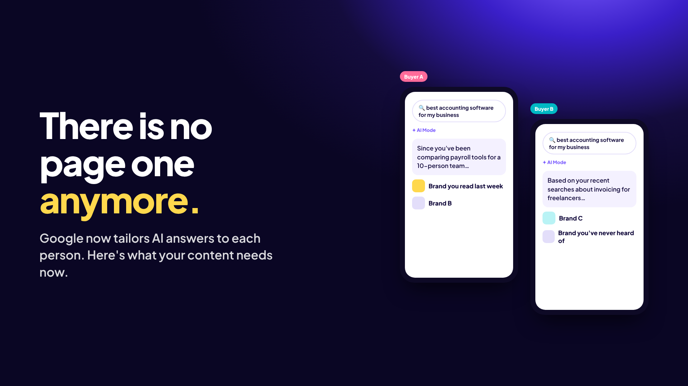
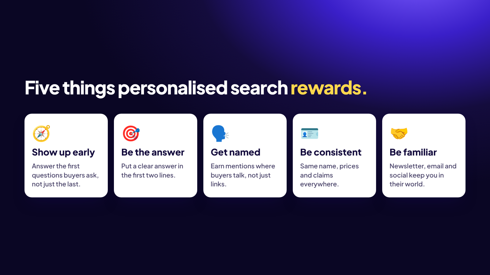

**Personalized search means Google's AI answers now depend partly on what each person searched for before and, if they opt in, on their own Google apps.** For brands, ranking for one keyword matters less than being part of a buyer's whole research journey. The content that wins answers early questions, states answers clearly, gets mentioned beyond your own website and keeps you familiar between searches.

## TL;DR

- On 23 November 2026, Google said AI Overviews and AI Mode will tailor answers to each person's recent searches. AI Mode can also now connect to Drive, Wallet and the Gemini app.
- Two people typing the same question can get different answers, so there is no single "page one" to win.
- Personalized search favors brands a buyer meets early, can quote, sees mentioned elsewhere and already trusts.
- SEO gets you found. AEO gets you quoted. GEO gets your brand named. Brands now need all three.
- Below: five content moves for December 2026 and three to plan for 2027.

## What did Google change in AI Mode and AI Overviews?

**Google made its AI answers more personal in two steps in 2026: app connections in January, then recent-search context and more apps in November.**

In January, Google [brought Personal Intelligence to AI Mode](https://blog.google/products-and-platforms/products/search/personal-intelligence-ai-mode-search/). People in the US on its AI Pro and Ultra plans could connect Gmail and Google Photos so AI Mode could make recommendations based on their own context. It was opt-in and labelled an experiment.

On 23 November, it went further. As [TechCrunch reported](https://techcrunch.com/2026/11/23/google-searchs-ai-mode-can-now-tap-into-drive-and-wallet-for-more-personalized-responses/), AI Mode can now also draw on Google Drive, Google Wallet and the Gemini app. Separately, AI Overviews and AI Mode will tailor answers to a person's recent search context, so someone researching a purchase can carry on without repeating what they need. Connecting apps stays optional, and Google says a "Personalization" icon is coming to show which context an answer used.

Google hasn't said every search will be personalized, or that rankings will change. But the direction is clear: the answer a buyer sees depends more and more on who they are and what they've already looked up.

## Why does personalized search matter for your content?

**Because the brand that helped a buyer earlier in their research now has an edge when they ask the buying question.**

Clicks were already moving into the answer itself. [Ahrefs found](https://ahrefs.com/blog/ai-overviews-reduce-clicks-update/) that when an AI Overview appears, the top-ranking page gets about 58% fewer clicks. In a field experiment with 1,100 Google users, researchers from the University of Pennsylvania and Northeastern University found that [AI Mode cut clicks to outside websites by 18.8 percentage points](https://www.techwyse.com/news/search-seo/google-ai-mode-reduces-publisher-clicks-study-2026).

Personalization adds a second shift. If the answer depends on someone's last few searches, content that only targets the final "best X for Y" query arrives too late.

Picture a small business owner comparing accounting tools. On Monday she searches "how to send invoices as a freelancer". On Wednesday, "best accounting software for my business". Her Monday questions now shape Wednesday's answer. If your guide answered them, she has already met you. If you only wrote the comparison page, you're one of many names she has never seen.

## What does personalized search reward?

**Five things: showing up early, being the answer, getting named, being consistent and staying familiar.**

### 1. Showing up early in the buyer's journey

Map the questions a buyer asks in order, from "what is" to "how do I" to "which one". Publish a clear answer for each stage, and link the pages together so a reader moves from one to the next.

### 2. Being the answer (AEO)

Answer engine optimization means writing so a page can be quoted. Put a one- or two-sentence answer at the top, use the question as the heading and keep paragraphs short. If someone copied only your first two lines, would they have the answer?

### 3. Getting your brand named (GEO)

Generative engine optimization is about being mentioned in AI answers. The researchers who coined the term found that [adding statistics, quotations and sources raised visibility in AI answers by up to 40%](https://arxiv.org/abs/2311.09735). Mentions in industry press, podcasts, reviews and communities matter as much as links. I covered this in more depth in [my guide to getting your brand named in AI answers](https://www.linkedin.com/pulse/generative-engine-optimization-geo-2026-how-get-your-brand-kalu-meyje).

### 4. Being consistent everywhere

Use the same company name, description, prices and claims on your website, LinkedIn, Google Business Profile and directories. Conflicting facts make it harder for an AI system to describe you with confidence.

### 5. Staying familiar between searches

Newsletters, emails, useful social posts and a recognizable point of view keep you in a buyer's world between searches. In a personalized system, being known is more than a vanity metric. It's likely an advantage.

## What is the difference between SEO, AEO and GEO?

- **SEO (search engine optimization)** makes sure search engines can find, crawl and rank your pages. Without it, nothing else works.
- **AEO (answer engine optimization)** shapes each page so it can be quoted as the direct answer to a question.
- **GEO (generative engine optimization)** builds the evidence and reputation that get your brand named when someone asks an AI for a recommendation.

## What I've seen in client work

**Answer-first content on a well-built site still moves results.** When I rebuilt Johan Consults' website for search and rewrote its content, inbound leads rose 60% and search traffic 25%, and they hired me back for a second rebuild. For Wezops, we fixed a confusing core message before writing more than 100 SEO articles. In both cases, the gain came from making every page answer a real buyer question clearly, which is exactly what personalized AI search now rewards. More in [my content marketing case studies](/content-marketing.html).

## What should brands do in December 2026?

1. **Fix your top 10 pages first.** Add a direct answer to the first two lines of each, plus a short FAQ.
2. **List your buyers' first questions.** Write down 10 questions people ask before they're ready to buy, and check which ones you answer.
3. **Clean up your facts.** Make your name, description and prices match everywhere.
4. **Publish one piece only you can.** A number, a case study or a price guide. Original evidence is what AI systems quote.
5. **Turn readers into subscribers.** Add a newsletter or WhatsApp opt-in to your most-read pages, so you stay in touch beyond search.

## What should brands plan for 2027?

- **Plan content by buyer journey, not keyword.** Build connected clusters that follow a buyer from first question to decision.
- **Budget for being talked about.** PR, partnerships, podcasts and community answers now feed AI visibility directly.
- **Measure beyond clicks.** Track branded searches, AI referrals in Google Analytics, mentions in AI answers and "How did you hear about us?" responses.

## Frequently asked questions

**What is personalized search in Google AI Mode?**  
It's Google tailoring AI answers to a person's recent searches and, if they choose, to information from connected apps such as Gmail, Photos, Drive, Wallet and the Gemini app.

**Is SEO dead now that Google personalizes AI answers?**  
No. SEO is still how your pages get found and indexed. Personalization changes which of those pages gets picked for each person, so SEO now needs AEO and GEO alongside it.

**How do I get my brand into Google AI Overviews?**  
Answer specific questions in the first lines of your pages, back claims with statistics and sources, earn mentions on other trusted sites and keep your business details consistent everywhere.

**What is the difference between AEO and GEO?**  
AEO makes a page easy to quote as the answer. GEO makes your brand more likely to be named in AI responses, mostly through evidence and mentions across the web.

**Can I see whether my content appears in personalized AI answers?**  
Not directly, because each person's answer can differ. Ask your buyers' questions in AI Mode, ChatGPT and Perplexity every month, track AI referral traffic in Google Analytics and ask new customers how they found you.

**Is Personal Intelligence available outside the US?**  
Google's January launch was limited to US users on AI Pro and Ultra plans, in English. Google hasn't confirmed which markets get the November additions.

*Also published on [LinkedIn](https://www.linkedin.com/pulse/google-ai-mode-now-personalized-what-means-seo-aeo-geo-chinedu-kalu-horze/), where you can join the conversation: which question do your buyers ask first, before they've ever heard of you?*

